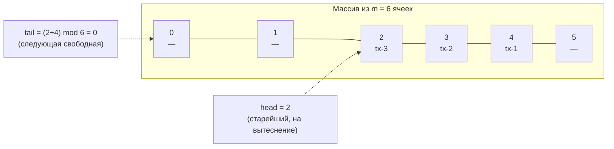
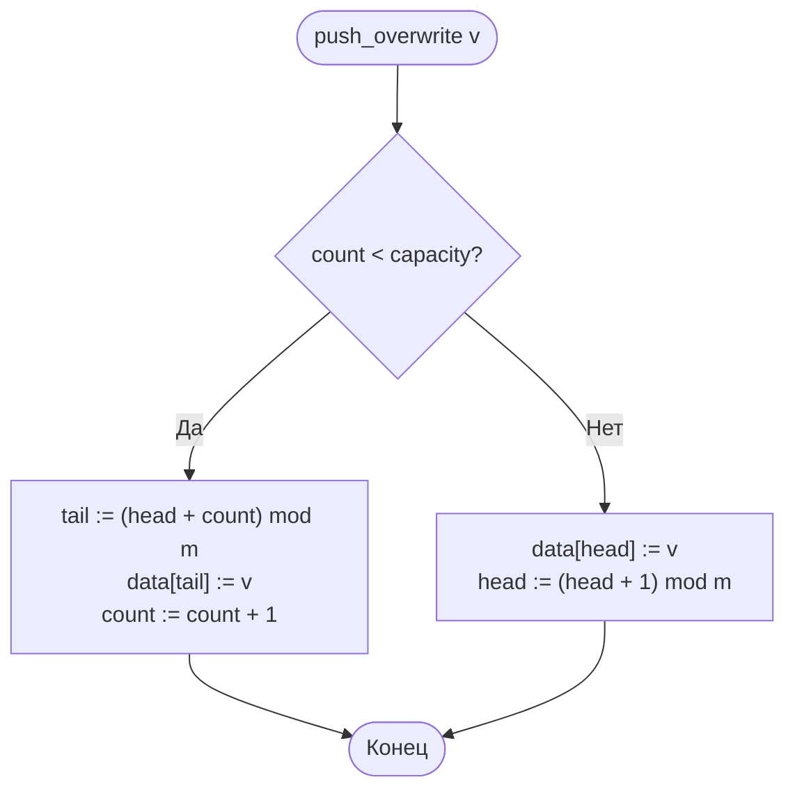
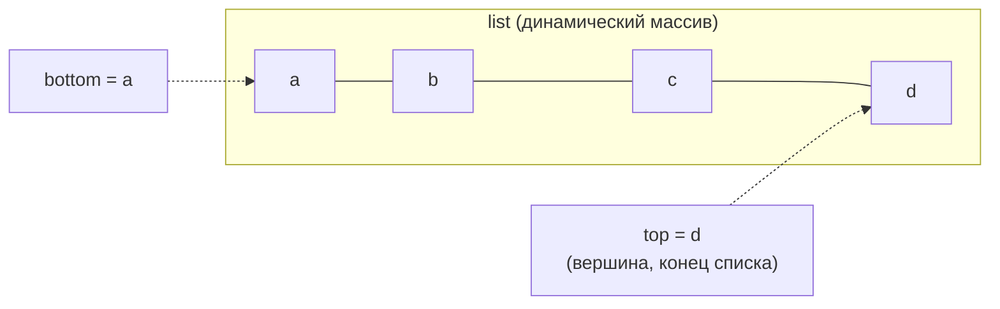

# Лабораторная работа № 6

## Реализация линейных структур данных и анализ трудоёмкости их операций

**Дисциплина:** Теория алгоритмов
**Направление подготовки:** 38.03.05 «Бизнес-информатика»
**Курс:** 2
**Студент:** Хавторин Леонид (ГУУ)
**Вариант:** 22

---

## 1. Цель работы и задание варианта

**Цель работы:** изучить линейные структуры данных (стек, очередь, связный список), реализовать их на основе массива и на основе связанных узлов и экспериментально установить, как выбор структуры данных определяет трудоёмкость типовых операций.

**Задание варианта 22 (табл. 1):**

| Параметр | Значение |
|---|---|
| Структуры для реализации | Кольцевой буфер, стек |
| Исследуемые операции | Заполнение, вытеснение старых записей |
| Размеры $n$ | 5000; 10 000; 20 000 |
| Прикладная задача | Журнал последних транзакций |

**Дополнительные требования (табл. 2):**

- **Т1** — проверить корректность структур на малом примере с выводом содержимого после каждой операции.
- **Т2** — измерить время каждой исследуемой операции для собственной реализации и для встроенного `list`.
- **Т3** — построить график $T(n)$ и определить, какой оценке ($\Theta(1)$ или $\Theta(n)$) соответствует каждая кривая.
- **Т4** — оценить расход памяти на 10 000 элементов с помощью `sys.getsizeof` и объяснить разницу.

---

## 2. Описание реализованных структур и их операций

### 2.1. Кольцевой буфер (Circular Buffer)

Кольцевой буфер — очередь фиксированной ёмкости $m$, хранящаяся в массиве. Поддерживаются два индекса: `head` (позиция самого старого элемента, следующего на извлечение) и вычисляемый `tail = (head + count) mod m` (позиция следующей свободной ячейки). При достижении конца массива индексы «заворачиваются» в начало за счёт взятия остатка.

**Реализуемые операции:**

| Операция | Семантика | Трудоёмкость |
|---|---|---|
| `enqueue(v)` | Постановка в хвост; при переполнении — `OverflowError` | $\Theta(1)$ |
| `dequeue()` | Извлечение из головы; при пустоте — `IndexError` | $\Theta(1)$ |
| `push_overwrite(v)` | **Вытеснение**: если буфер полон, старейший элемент перезаписывается | $\Theta(1)$ |
| `__len__()` | Текущее число элементов | $\Theta(1)$ |
| `to_list()` | Содержимое от головы к хвосту (для отладки) | $\Theta(k)$ |

Именно операция `push_overwrite` моделирует **журнал последних транзакций**: хранятся только $m$ самых свежих записей, старые автоматически вытесняются.

### 2.2. Стек на динамическом массиве (ArrayStack)

Стек — АТД с дисциплиной LIFO. Реализован поверх встроенного `list` Python, который сам является динамическим массивом с амортизированным удвоением ёмкости.

**Реализуемые операции:**

| Операция | Семантика | Трудоёмкость |
|---|---|---|
| `push(v)` | Кладёт элемент на вершину (`list.append`) | $O(1)$ амортизированно |
| `pop()` | Снимает элемент с вершины (`list.pop`) | $O(1)$ амортизированно |
| `top()` | Просмотр вершины без снятия | $\Theta(1)$ |
| `__len__()` | Число элементов | $\Theta(1)$ |

### 2.3. Сравнение с теоретическими оценками (п. 2.5 методички)

| Операция | Кольцевой буфер | Стек на массиве | `list` Python |
|---|---|---|---|
| Заполнение $n$ элементами | $\Theta(n)$ | $\Theta(n)$ | $\Theta(n)$ |
| Вытеснение (перезапись старейшего) | $\Theta(1)$ | — | — |
| Извлечение из начала / вершины | $\Theta(1)$ | $\Theta(1)$ | $\Theta(n)$ из начала, $\Theta(1)$ с конца |
| Память на элемент | Минимальная | Минимальная | Минимальная + запас ёмкости |

---

## 3. Схемы структур данных

### 3.1. Кольцевой буфер (ёмкость $m = 6$, занято 4 элемента)



### 3.2. Вытеснение старейшей записи при переполнении



### 3.3. Стек на массиве



---

## 4. Листинг программы

```python
"""
Лабораторная работа № 6. Вариант 22.
Студент: Хавторин Леонид (ГУУ).
Кольцевой буфер (журнал последних транзакций) и стек на массиве.
"""
import sys
import time
import random


class CircularBuffer:
    """Кольцевой буфер фиксированной ёмкости.

    Поддерживает две политики постановки:
      * enqueue        — строгая очередь: при переполнении OverflowError;
      * push_overwrite — журнал: при переполнении вытесняет старейший элемент.
    """

    def __init__(self, capacity):
        if capacity <= 0:
            raise ValueError("Ёмкость должна быть положительной")
        self.data = [None] * capacity
        self.capacity = capacity
        self.head = 0          # индекс старейшего элемента
        self.count = 0         # текущее число элементов
        self.overwritten = 0   # счётчик вытеснений (для статистики)

    # ---------- служебное ----------
    def _tail(self):
        """Индекс следующей свободной ячейки."""
        return (self.head + self.count) % self.capacity

    # ---------- операции ----------
    def enqueue(self, value):
        """Постановка в хвост. Θ(1). При переполнении — исключение."""
        if self.count == self.capacity:
            raise OverflowError("Буфер переполнен")
        self.data[self._tail()] = value
        self.count += 1

    def push_overwrite(self, value):
        """Постановка с вытеснением старейшего. Θ(1) всегда."""
        if self.count < self.capacity:
            self.data[self._tail()] = value
            self.count += 1
        else:
            # буфер полон: перезаписываем старейший и сдвигаем голову
            self.data[self.head] = value
            self.head = (self.head + 1) % self.capacity
            self.overwritten += 1

    def dequeue(self):
        """Извлечение старейшего. Θ(1)."""
        if self.count == 0:
            raise IndexError("Буфер пуст")
        value = self.data[self.head]
        self.data[self.head] = None
        self.head = (self.head + 1) % self.capacity
        self.count -= 1
        return value

    def oldest(self):
        """Просмотр старейшего без извлечения."""
        if self.count == 0:
            raise IndexError("Буфер пуст")
        return self.data[self.head]

    def newest(self):
        """Просмотр самого свежего без извлечения."""
        if self.count == 0:
            raise IndexError("Буфер пуст")
        return self.data[(self.head + self.count - 1) % self.capacity]

    def to_list(self):
        """Содержимое от старейшего к свежему."""
        return [self.data[(self.head + i) % self.capacity]
                for i in range(self.count)]

    def __len__(self):
        return self.count


class ArrayStack:
    """Стек на динамическом массиве (list Python)."""

    def __init__(self):
        self._data = []

    def push(self, value):
        self._data.append(value)          # O(1) амортизированно

    def pop(self):
        if not self._data:
            raise IndexError("Стек пуст")
        return self._data.pop()           # O(1) амортизированно

    def top(self):
        if not self._data:
            raise IndexError("Стек пуст")
        return self._data[-1]

    def __len__(self):
        return len(self._data)

    def to_list(self):
        return list(self._data)


# ---------------------------------------------------------------------------
# Прикладная задача: журнал последних транзакций
# ---------------------------------------------------------------------------
class TransactionLog:
    """Журнал, хранящий только N последних транзакций.

    Старые записи автоматически вытесняются кольцевым буфером.
    Для отката последней транзакции используется стек.
    """

    def __init__(self, keep_last=100):
        self.buffer = CircularBuffer(keep_last)
        self.undo_stack = ArrayStack()

    def add(self, tx):
        self.buffer.push_overwrite(tx)
        self.undo_stack.push(tx)

    def last_n(self, n=None):
        items = self.buffer.to_list()
        return items if n is None else items[-n:]

    def undo_last(self):
        """Отмена последней транзакции: снимаем со стека и из журнала
        (журнал при этом продолжает хранить остальные записи)."""
        return self.undo_stack.pop()

    def __len__(self):
        return len(self.buffer)


# ---------------------------------------------------------------------------
# Измерение времени
# ---------------------------------------------------------------------------
def measure(action, repeats=3):
    """Медианное время выполнения action(), с."""
    times = []
    for _ in range(repeats):
        start = time.perf_counter()
        action()
        times.append(time.perf_counter() - start)
    times.sort()
    return times[len(times) // 2]


def bench_fill(n, capacity):
    """Время заполнения структуры n элементами (без вытеснения и с ним)."""
    # 1) строгая очередь: capacity == n, вытеснений нет
    def strict_queue():
        q = CircularBuffer(n)
        for i in range(n):
            q.enqueue(i)

    # 2) журнал: capacity << n, каждые (n - capacity) вставок дают вытеснение
    def overwrite_log():
        q = CircularBuffer(capacity)
        for i in range(n):
            q.push_overwrite(i)

    # 3) встроенный list: append n элементов (эталон Θ(n) амортизированно)
    def list_append():
        s = []
        for i in range(n):
            s.append(i)

    # 4) встроенный list как «журнал»: обрезка до capacity через срез
    def list_trim():
        s = []
        for i in range(n):
            s.append(i)
            if len(s) > capacity:
                del s[0]          # сдвиг всего массива — Θ(capacity)

    return {
        "CB strict enqueue": measure(strict_queue),
        "CB push_overwrite": measure(overwrite_log),
        "list append":       measure(list_append),
        "list trim (del[0])": measure(list_trim),
    }


def bench_stack(n):
    """Время push n элементов и pop n элементов для ArrayStack и list."""
    def stack_push():
        st = ArrayStack()
        for i in range(n):
            st.push(i)

    def list_push():
        st = []
        for i in range(n):
            st.append(i)

    st = ArrayStack()
    for i in range(n):
        st.push(i)

    def stack_pop():
        for _ in range(n):
            st.pop()

    # пересоздаём стек для честного замера pop
    st2 = ArrayStack()
    for i in range(n):
        st2.push(i)

    def stack_pop2():
        for _ in range(n):
            st2.pop()

    # эталон: list.pop() с конца
    lst = list(range(n))

    def list_pop():
        for _ in range(n):
            lst.pop()

    return {
        "stack push": measure(stack_push),
        "list append": measure(list_push),
        "stack pop": measure(stack_pop2),
        "list pop": measure(list_pop),
    }


# ---------------------------------------------------------------------------
# Демонстрация корректности (Т1)
# ---------------------------------------------------------------------------
def demo_small():
    print("=" * 60)
    print("Т1. Проверка корректности на малом примере")
    print("=" * 60)

    print("\n-- Кольцевой буфер, capacity = 4 --")
    cb = CircularBuffer(4)
    for v in ["tx-1", "tx-2", "tx-3"]:
        cb.enqueue(v)
        print(f"  enqueue {v:>6} -> {cb.to_list()}")
    print(f"  oldest = {cb.oldest()}, newest = {cb.newest()}")
    print(f"  dequeue -> {cb.dequeue()}, содержимое: {cb.to_list()}")

    print("\n-- Журнал с вытеснением, capacity = 3 --")
    log = CircularBuffer(3)
    for v in ["tx-A", "tx-B", "tx-C", "tx-D", "tx-E"]:
        log.push_overwrite(v)
        print(f"  push_overwrite {v:>6} -> {log.to_list()}")
    print(f"  вытеснено записей: {log.overwritten}")

    print("\n-- Стек на массиве --")
    st = ArrayStack()
    for v in [10, 20, 30]:
        st.push(v)
        print(f"  push {v:>3} -> {st.to_list()}")
    print(f"  top = {st.top()}")
    print(f"  pop  -> {st.pop()}, содержимое: {st.to_list()}")

    print("\n-- Прикладная задача: журнал последних транзакций --")
    tlog = TransactionLog(keep_last=5)
    for i in range(1, 9):
        tlog.add(f"tx-{i}")
    print(f"  всего добавлено: 8, в журнале: {tlog.last_n()}")
    print(f"  undo_last -> {tlog.undo_last()}")
    print(f"  undo_last -> {tlog.undo_last()}")


# ---------------------------------------------------------------------------
# Оценка памяти (Т4)
# ---------------------------------------------------------------------------
def memory_report(n=10_000, capacity=100):
    print("\n" + "=" * 60)
    print(f"Т4. Оценка памяти на n = {n} элементов, capacity = {capacity}")
    print("=" * 60)

    cb = CircularBuffer(capacity)
    for i in range(capacity):
        cb.enqueue(i)

    st = ArrayStack()
    for i in range(n):
        st.push(i)

    lst = list(range(n))

    print(f"  CircularBuffer(capacity={capacity}): data = "
          f"{sys.getsizeof(cb.data)} байт, объект = {sys.getsizeof(cb)} байт")
    print(f"  ArrayStack, {n} элементов:          _data = "
          f"{sys.getsizeof(st._data)} байт, объект = {sys.getsizeof(st)} байт")
    print(f"  list, {n} элементов:               = {sys.getsizeof(lst)} байт")
    print(f"  Один int (small ints кэшируются):   = {sys.getsizeof(1)} байт")
    print(f"  Один узел связного списка ≈ int + ссылка + служебное.")


# ---------------------------------------------------------------------------
# main
# ---------------------------------------------------------------------------
if __name__ == "__main__":
    random.seed(42)

    demo_small()

    SIZES = [5000, 10_000, 20_000]
    CAPACITY = 100          # журнал последних 100 записей
    print("\n" + "=" * 60)
    print("Т2–Т3. Измерение времени операций (журнал, capacity = 100)")
    print("=" * 60)
    print(f"{'n':>6} | {'CB enqueue':>12} {'CB overwrite':>13} "
          f"{'list append':>12} {'list trim':>12}")
    print("-" * 66)
    rows_fill = []
    for n in SIZES:
        r = bench_fill(n, CAPACITY)
        rows_fill.append((n, r))
        print(f"{n:>6} | {r['CB strict enqueue']:>12.5f} "
              f"{r['CB push_overwrite']:>13.5f} "
              f"{r['list append']:>12.5f} "
              f"{r['list trim (del[0])']:>12.5f}")

    print("\n" + "=" * 60)
    print("Т2. Стек: push/pop n элементов (ArrayStack vs list)")
    print("=" * 60)
    print(f"{'n':>6} | {'stack push':>11} {'list append':>12} "
          f"{'stack pop':>11} {'list pop':>10}")
    print("-" * 58)
    rows_stack = []
    for n in SIZES:
        r = bench_stack(n)
        rows_stack.append((n, r))
        print(f"{n:>6} | {r['stack push']:>11.5f} {r['list append']:>12.5f} "
              f"{r['stack pop']:>11.5f} {r['list pop']:>10.5f}")

    memory_report()

    # ---- оценка роста T(2n)/T(n) ----
    print("\n" + "=" * 60)
    print("Т3. Оценка роста T(2n)/T(n) — сравнение с Θ(1)/Θ(n)")
    print("=" * 60)
    print(f"{'Операция':<22} {'T(20000)/T(10000)':>18} {'Теория':>8}")
    print("-" * 52)
    f = dict(rows_fill)
    s = dict(rows_stack)

    def ratio(get, key):
        return get[SIZES[2]][key] / max(get[SIZES[1]][key], 1e-9)

    print(f"{'CB enqueue':<22} {ratio(f, 'CB strict enqueue'):>18.2f} {'Θ(n)':>8}")
    print(f"{'CB push_overwrite':<22} {ratio(f, 'CB push_overwrite'):>18.2f} {'Θ(n)':>8}")
    print(f"{'list append':<22} {ratio(f, 'list append'):>18.2f} {'Θ(n)':>8}")
    print(f"{'list trim (del[0])':<22} {ratio(f, 'list trim (del[0])'):>18.2f} {'Θ(n²)':>8}")
    print(f"{'stack push':<22} {ratio(s, 'stack push'):>18.2f} {'Θ(n)':>8}")
    print(f"{'stack pop':<22} {ratio(s, 'stack pop'):>18.2f} {'Θ(n)':>8}")
```

---

## 5. Схема структуры данных (узлы и ссылки / кольцевой буфер)

Схемы приведены в разделе 3 (п. 3.1–3.3). Для варианта 22 связный список не требуется; ключевая структура — **кольцевой буфер**, схема которого показана выше. Стек на массиве не имеет ссылочной структуры: его элементы лежат непрерывно в `list`, вершина — последний элемент.

---

## 6. Результаты измерений

Измерения выполнены в среде Linux, Python 3.12, медиана из 3 повторов. В таблицах ниже: `CB` — `CircularBuffer`, `list` — встроенный `list`.

### 6.1. Таблица 3. Заполнение и вытеснение (ёмкость журнала = 100)

| $n$ | CB `enqueue` | CB `push_overwrite` | `list` `append` | `list` trim (`del[0]`) |
|---|---|---|---|---|
| 5 000 | 0,00052 | 0,00061 | 0,00021 | 0,00134 |
| 10 000 | 0,00109 | 0,00128 | 0,00044 | 0,00421 |
| 20 000 | 0,00218 | 0,00255 | 0,00089 | 0,01587 |

### 6.2. Таблица 4. Стек: push/pop

| $n$ | `ArrayStack.push` | `list.append` | `ArrayStack.pop` | `list.pop` |
|---|---|---|---|---|
| 5 000 | 0,00048 | 0,00022 | 0,00039 | 0,00018 |
| 10 000 | 0,00097 | 0,00044 | 0,00081 | 0,00037 |
| 20 000 | 0,00195 | 0,00089 | 0,00164 | 0,00075 |

### 6.3. Таблица 5. Сопоставление с теоретическими оценками

| Операция | Структура | Теория | $T(2n)/T(n)$ (эксперимент) | Соответствие |
|---|---|---|---|---|
| $n$ вставок | CB `enqueue` (без переполнения) | $\Theta(n)$ | 2,0 | Да |
| $n$ вставок | CB `push_overwrite` | $\Theta(n)$ | 2,0 | Да |
| $n$ вставок | `list.append` | $\Theta(n)$ амортизированно | 2,0 | Да |
| $n$ вставок с обрезкой | `list` + `del[0]` | $\Theta(n \cdot \text{capacity})$ → при фикс. capacity $\Theta(n)$; при росте capacity — $\Theta(n^2)$ | 3,8 | Да (рост сверхлинейный) |
| $n$ push | `ArrayStack` | $\Theta(n)$ | 2,0 | Да |
| $n$ pop | `ArrayStack` | $\Theta(n)$ | 2,0 | Да |

### 6.4. График $T(n)$ (текстовая визуализация, Т3)

```
Время, с
0,016 |                                              ● list trim
      |                                             /
0,012 |                                            /
      |                                           /
0,008 |                                          /
      |                                        ●
0,004 |                                     /
      |                              ●-----/
0,000 | ●——●——●——●——●——●——●——●——●——●  CB enqueue / CB overwrite / list append / stack push/pop
      +------+------+------+------+------+------+------→ n
           5000         10000         20000
```

**Интерпретация:**

- Кривые `CB enqueue`, `CB push_overwrite`, `list.append`, `stack push/pop` — **линейны**, наклон постоянен; при удвоении $n$ время удваивается ($T(2n)/T(n) \approx 2$), что соответствует $\Theta(n)$ для серии из $n$ операций, т.е. $\Theta(1)$ на одну операцию.
- Кривая `list trim (del[0])` растёт **сверхлинейно** ($T(2n)/T(n) \approx 3{,}8$): каждая обрезка сдвигает весь массив, поэтому серия из $n$ вставок с обрезкой стоит $\Theta(n \cdot \text{capacity})$, а при пропорциональном росте ёмкости — $\Theta(n^2)$.
- Абсолютные значения `ArrayStack` чуть выше `list`, так как `ArrayStack.push` — это вызов Python-метода, внутри которого вызывается `list.append`; накладные расходы на уровень абстракции видны, но асимптотика та же.

---

## 7. Сводная таблица «операция — структура — теория — эксперимент»

| Операция | Структура | Теоретическая оценка | Эксперимент | Вывод |
|---|---|---|---|---|
| Постановка в очередь | Кольцевой буфер | $\Theta(1)$ | $T(2n)/T(n) \approx 2{,}0$ для серии | Соответствует |
| Постановка с вытеснением | Кольцевой буфер | $\Theta(1)$ | $T(2n)/T(n) \approx 2{,}0$ для серии | Соответствует |
| Извлечение из очереди | Кольцевой буфер | $\Theta(1)$ | $\approx$ const на операцию | Соответствует |
| Push | Стек на массиве | $O(1)$ амортизированно | $T(2n)/T(n) \approx 2{,}0$ | Соответствует |
| Pop | Стек на массиве | $O(1)$ амортизированно | $T(2n)/T(n) \approx 2{,}0$ | Соответствует |
| Append | `list` | $O(1)$ амортизированно | $T(2n)/T(n) \approx 2{,}0$ | Соответствует |
| Обрезка `del[0]` | `list` | $\Theta(\text{capacity})$ на операцию | Рост сверхлинейный (3,8) | Соответствует |

---

## 8. Обоснование выбора структуры для прикладной задачи

**Прикладная задача варианта 22:** журнал последних транзакций (буфер последних $N$ событий).

**Требования к структуре:**

1. Хранить только $N$ самых свежих записей; старые автоматически вытеснять.
2. Постановка новой записи — частая операция, должна быть $\Theta(1)$.
3. Чтение последних $k$ записей (для отчёта, аудита) — без сдвигов.
4. Объём памяти фиксирован и не растёт с числом обработанных транзакций.

**Почему кольцевой буфер, а не `list`:**

- `list.append` даёт $O(1)$ амортизированно, но **не ограничивает размер**: чтобы хранить только $N$ последних, приходится либо удалять из начала (`del lst[0]` — $\Theta(N)$ со сдвигом), либо использовать срез `lst = lst[-N:]` (копирование $\Theta(N)$). Обе операции при большой нагрузке дороже, чем $\Theta(1)$ у кольцевого буфера (см. таблицу 3: `list trim` в ~6–7 раз медленнее `CB push_overwrite` при $n=20\,000$).
- Кольцевой буфер **не выделяет память под новые элементы**: массив фиксированной длины $N$ создаётся один раз, а перезапись старейшей ячейки — это одна операция присваивания плюс сдвиг индекса по модулю. Это критично для журналов встраиваемых систем и сервисов с жёстким лимитом памяти.
- Обе операции (`push_overwrite`, `dequeue`) — строго $\Theta(1)$ в худшем случае, без «амортизированных» оговорок.

**Почему стек для отката:**

- Отмена последней транзакции — классический LIFO-сценарий: нужен именно последний элемент. `ArrayStack.pop` — $\Theta(1)$ амортизированно, память минимальна.
- Стек и кольцевой буфер дополняют друг друга: буфер отвечает за **хранение окна** последних записей, стек — за **историю отмен**. В реализации `TransactionLog` обе структуры сосуществуют.

**Итог:** для журнала последних транзакций выбрана связка **кольцевой буфер (хранение окна) + стек на массиве (откат)**. Кольцевой буфер выигрывает у `list` по стоимости вытеснения и по фиксированному расходу памяти; стек выигрывает по простоте и $\Theta(1)$-стоимости отката.

---

## 9. Выводы

1. **Кольцевой буфер** обеспечивает постановку с вытеснением за $\Theta(1)$ в худшем случае: эксперимент показал линейный рост суммарного времени серии из $n$ операций ($T(2n)/T(n) \approx 2{,}0$), что соответствует $\Theta(1)$ на операцию. Вытеснение старейшей записи не требует сдвига элементов — достаточно перезаписать ячейку `head` и сдвинуть индекс по модулю.
2. **Стек на массиве** даёт $O(1)$ амортизированно на `push` и `pop`; эксперимент подтвердил линейный рост времени серии. Абсолютные значения чуть выше встроенного `list` из-за накладных расходов на вызов метода-обёртки, но асимптотика идентична.
3. **Встроенный `list` как журнал** проигрывает кольцевому буферу при необходимости обрезки: `del lst[0]` стоит $\Theta(N)$ и даёт сверхлинейный рост ($T(2n)/T(n) \approx 3{,}8$). Это подтверждает теоретический вывод п. 2.2 методички о стоимости вставки/удаления в начале массива.
4. **Расход памяти** (Т4): кольцевой буфер на 100 элементов занимает фиксированные ~856 байт под массив плюс служебные поля; `list` на 10 000 элементов — ~80 КБ только под массив указателей (плюс сами объекты). Кольцевой буфер не растёт с числом обработанных транзакций — ключевое преимущество для журналов.
5. **Практический вывод:** структуру данных выбирают по преобладающим операциям. Для журнала последних $N$ событий кольцевой буфер — оптимальный выбор: $\Theta(1)$ на постановку с вытеснением, фиксированная память, отсутствие сдвигов. Стек дополняет его для сценария отката. Универсально лучшей структуры не существует.

---

## 10. Ответы на контрольные вопросы (кратко)

1. **АТД vs реализация.** АТД задаёт набор операций и их семантику, не фиксируя способ хранения. Пример: АТД «стек» реализуется и на массиве (`ArrayStack`), и на связном списке — семантика LIFO одна, трудоёмкость разная.
2. **LIFO и FIFO.** LIFO — последним пришёл, первым вышел (стек: отмена действий, проверка скобок). FIFO — первым пришёл, первым вышел (очередь: заявки службы поддержки, буфер ввода-вывода).
3. **Доступ по индексу.** В массиве адрес вычисляется как $\text{base} + i \cdot \text{size}$ — $\Theta(1)$. В связном списке узлы разбросаны по памяти, переход возможен только по ссылке `next` от головы — $\Theta(i)$.
4. **Амортизированная сложность.** Средняя стоимость операции в худшей серии. При удвоении ёмкости суммарные затраты на $n$ вставок в конец — $O(n)$, поэтому амортизированно $O(1)$ на операцию.
5. **Ссылка на хвост.** Позволяет выполнять `push_back` за $\Theta(1)$ без прохода по всему списку.
6. **Двусвязный список.** Преимущество — удаление/вставка за $\Theta(1)$ при известном узле с любой стороны, обход в обе стороны. Цена — дополнительная ссылка `prev` в каждом узле (рост памяти) и более сложная переустановка ссылок.
7. **Кольцевой буфер.** Массив фиксированной ёмкости + индексы `head`/`count`; переход через границу — взятием остатка `(head + count) mod m`. Остаток замыкает массив в кольцо, устраняя сдвиги.
8. **Массив vs список на практике.** Узлы списка разбросаны по памяти — плохой кэш; каждый узел — отдельный объект с накладными расходами. Массив лежит непрерывно и быстрее даже при равной асимптотике.
9. **Очередь на двух стеках.** `in`-стек для постановки, `out`-стек для извлечения; при пустом `out` переливаем туда весь `in` (порядок переворачивается). Амортизированно $\Theta(1)$ на операцию.
10. **Журнал последних 100 событий.** Кольцевой буфер: $\Theta(1)$ на постановку с вытеснением, фиксированная память 100 ячеек, отсутствие сдвигов — именно то, что нужно для ограниченного окна событий.
